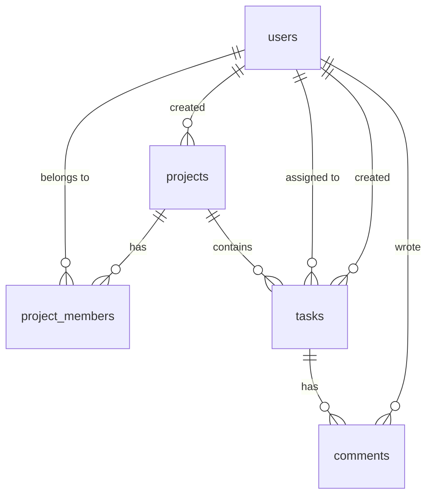

# 02 — Data Model (Domain Model)

## 1. Entity relationship overview


## 2. Tables
| Table | Purpose | Key columns |
|---|---|---|
| `users` | Accounts and the global role | `email` (unique, lowercase), `password_hash`, `role`, `is_active` |
| `projects` | Projects | `name`, `status` (ACTIVE/ARCHIVED), `created_by_id` |
| `project_members` | Membership and project-level role | composite PK `(project_id, user_id)`, `role` |
| `tasks` | Tasks | `project_id`, `status`, `priority`, `assignee_id`, `due_date`, **`version`** |
| `comments` | Task comments | `task_id`, `author_id`, `body` |

The brief mentions a `roles` table; here roles are Postgres enums (`GlobalRole`, `ProjectRole`) because the four roles are fixed and enums give type safety with no joins. Mention this decision in your architecture note.

## 3. Prisma schema (`backend/prisma/schema.prisma`)
```prisma
generator client {
  provider = "prisma-client-js"
}

datasource db {
  provider = "postgresql"
  url      = env("DATABASE_URL")
}

enum GlobalRole {
  ADMIN
  PROJECT_MANAGER
  TEAM_MEMBER
  VIEWER
}

enum ProjectRole {
  PROJECT_MANAGER
  TEAM_MEMBER
  VIEWER
}

enum ProjectStatus {
  ACTIVE
  ARCHIVED
}

enum TaskStatus {
  TODO
  IN_PROGRESS
  IN_REVIEW
  DONE
}

enum TaskPriority {
  LOW
  MEDIUM
  HIGH
  URGENT
}

model User {
  id           String     @id @default(uuid()) @db.Uuid
  email        String     @unique
  name         String
  passwordHash String     @map("password_hash")
  role         GlobalRole @default(TEAM_MEMBER)
  isActive     Boolean    @default(true) @map("is_active")
  createdAt    DateTime   @default(now()) @map("created_at")
  updatedAt    DateTime   @updatedAt @map("updated_at")

  memberships     ProjectMember[]
  projectsCreated Project[]       @relation("ProjectCreator")
  tasksAssigned   Task[]          @relation("TaskAssignee")
  tasksCreated    Task[]          @relation("TaskCreator")
  comments        Comment[]

  @@map("users")
}

model Project {
  id          String        @id @default(uuid()) @db.Uuid
  name        String
  description String?
  status      ProjectStatus @default(ACTIVE)
  createdById String        @map("created_by_id") @db.Uuid
  createdAt   DateTime      @default(now()) @map("created_at")
  updatedAt   DateTime      @updatedAt @map("updated_at")
  archivedAt  DateTime?     @map("archived_at")

  createdBy User            @relation("ProjectCreator", fields: [createdById], references: [id])
  members   ProjectMember[]
  tasks     Task[]

  @@index([status])
  @@map("projects")
}

model ProjectMember {
  projectId String      @map("project_id") @db.Uuid
  userId    String      @map("user_id") @db.Uuid
  role      ProjectRole @default(TEAM_MEMBER)
  addedAt   DateTime    @default(now()) @map("added_at")

  project Project @relation(fields: [projectId], references: [id], onDelete: Cascade)
  user    User    @relation(fields: [userId], references: [id], onDelete: Cascade)

  @@id([projectId, userId])
  @@index([userId])
  @@map("project_members")
}

model Task {
  id          String       @id @default(uuid()) @db.Uuid
  projectId   String       @map("project_id") @db.Uuid
  title       String
  description String?
  status      TaskStatus   @default(TODO)
  priority    TaskPriority @default(MEDIUM)
  assigneeId  String?      @map("assignee_id") @db.Uuid
  createdById String       @map("created_by_id") @db.Uuid
  dueDate     DateTime?    @map("due_date") @db.Date
  version     Int          @default(1)
  createdAt   DateTime     @default(now()) @map("created_at")
  updatedAt   DateTime     @updatedAt @map("updated_at")

  project   Project   @relation(fields: [projectId], references: [id], onDelete: Cascade)
  assignee  User?     @relation("TaskAssignee", fields: [assigneeId], references: [id], onDelete: SetNull)
  createdBy User      @relation("TaskCreator", fields: [createdById], references: [id])
  comments  Comment[]

  @@index([projectId, status])
  @@index([assigneeId])
  @@map("tasks")
}

model Comment {
  id        String   @id @default(uuid()) @db.Uuid
  taskId    String   @map("task_id") @db.Uuid
  authorId  String   @map("author_id") @db.Uuid
  body      String
  createdAt DateTime @default(now()) @map("created_at")

  task   Task @relation(fields: [taskId], references: [id], onDelete: Cascade)
  author User @relation(fields: [authorId], references: [id])

  @@index([taskId, createdAt])
  @@map("comments")
}
```

## 4. Integrity rules
- Emails are lowercased and trimmed before insert and lookup (BR-1).
- Users are never hard-deleted (only `is_active = false`), so foreign keys from tasks/comments stay valid.
- Deleting a project cascades to members, tasks and comments. Deleting a task cascades to comments.
- `tasks.assignee_id` is `SET NULL` if the user row ever disappears. The app also unassigns explicitly when a member is removed (BR-8).
- `version` starts at 1 and is incremented only through the guarded update (see `05_ARCHITECTURE.md` §6).
- Rules that need cross-table checks (assignee must be an active non-viewer member, project role vs global role) are enforced in the service layer inside transactions, not by DB constraints.

## 5. Commands
```powershell
cd backend
npx prisma migrate dev --name init     # create and apply the migration
npx prisma generate
npm run seed                           # runs prisma/seed.ts
npx prisma studio                      # optional DB browser
# reset everything during development:
npx prisma migrate reset               # drops, re-migrates, re-seeds
```
`package.json` should contain `"prisma": { "seed": "tsx prisma/seed.ts" }` and a script `"seed": "tsx prisma/seed.ts"`.

## 6. Seed data (idempotent; refuses to run if `NODE_ENV=production`)
The seed deletes rows in dependency order (comments, tasks, project_members, projects, users) and recreates them. Hash passwords with `bcryptjs`.

### Users
| Name | Email | Password | Global role | Active |
|---|---|---|---|---|
| Alice Admin | `admin@example.com` | `Admin@123` | ADMIN | yes |
| Priya Manager | `pm1@example.com` | `Password@123` | PROJECT_MANAGER | yes |
| Paul Manager | `pm2@example.com` | `Password@123` | PROJECT_MANAGER | yes |
| Maya Member | `member1@example.com` | `Password@123` | TEAM_MEMBER | yes |
| Mike Member | `member2@example.com` | `Password@123` | TEAM_MEMBER | yes |
| Vera Viewer | `viewer@example.com` | `Password@123` | VIEWER | yes |
| Ian Inactive | `inactive@example.com` | `Password@123` | TEAM_MEMBER | **no** |

### Projects, members and tasks
| Project | Status | Members (project role) | Purpose |
|---|---|---|---|
| Website Redesign | ACTIVE | pm1 (PM), member1 (TM), member2 (TM), viewer (VIEWER) | Main demo project, 6 tasks in mixed statuses/priorities, some assigned to member1, some to member2, one unassigned, one overdue |
| Mobile App Launch | ACTIVE | pm2 (PM), member1 (TM), viewer (VIEWER) | **member2 and pm1 are not members**: used for cross-project 403 tests; 4 tasks |
| Legacy Migration | ARCHIVED | pm1 (PM), member1 (TM) | Read-only behavior test; 2 tasks |

Add 2–3 comments on tasks in "Website Redesign" (by member1, pm1, member2). Print the sample credentials at the end of the seed run.
